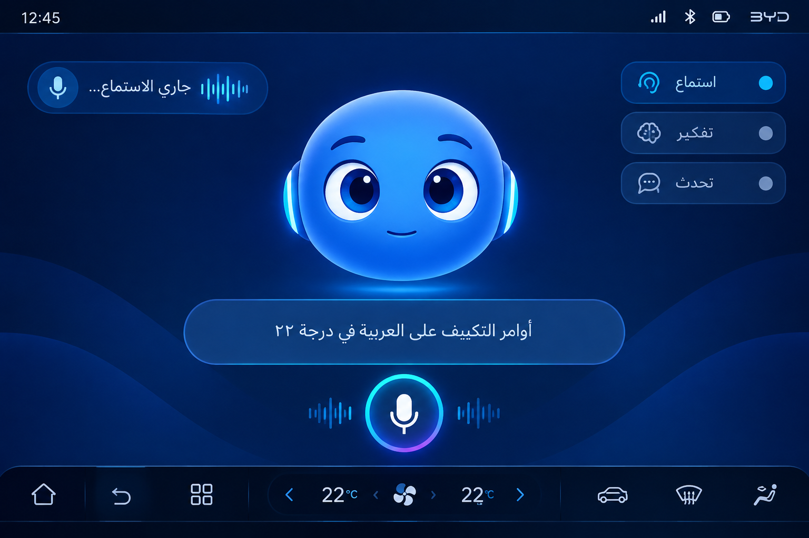

# AI Friend for BYD DiLink

Android/Kotlin prototype for a full-screen AI companion running on a BYD DiLink head unit.

## UI concept



## Product concept

- Full-screen blue 3D-cartoon face.
- Face has eyes only: no mouth or nose.
- Eyes blink, gaze, react to listening/thinking/speaking states.
- Arabic (Egypt) voice input using Android `SpeechRecognizer` with `ar-EG`.
- Transcript is shown live while listening.
- Initial local command router demonstrates vehicle actions such as climate and windows.
- A dedicated `VehicleController` interface is ready for the real BYD `autoservice`/Binder integration.

## Architecture

```text
MainActivity
  └── MainViewModel
       ├── ArabicSpeechRecognizer
       ├── AssistantEngine
       │    └── VehicleController
       │         └── StubVehicleController (replace with DiLink bridge)
       └── Compose UI
            └── AiFace Canvas animation
```

## Current milestone

This repository intentionally stops before hard-coding hidden BYD Binder contracts. The next integration step is to inspect the target Song Plus DiLink build and implement the `VehicleController` using the same system-facing mechanism identified in BYDMate.

## Build

Open the project in Android Studio and build the `app` module. The project targets API 35, minimum API 29, and landscape orientation.

## Voice flow

`Tap microphone → SpeechRecognizer (ar-EG) → partial transcript → final transcript → AssistantEngine → vehicle action / response state`.

The current command router is deliberately small. It is a test seam for the real LLM tool-calling layer, which should be added later.

## BYD integration note

BYDMate documents that vehicle automation is performed through the vehicle's system service (`autoservice`) and that different BYD models/firmwares expose different parameter catalogs. This project does not copy BYDMate source code; it only defines an independent abstraction (`VehicleController`) so the integration can be implemented after collecting the exact catalog from the user's Song Plus head unit.

Reference: https://github.com/AndyShaman/BYDMate

## License

This prototype is original code written for this project. No BYDMate source files are included. Review BYDMate's own license before reusing any of its source code.
